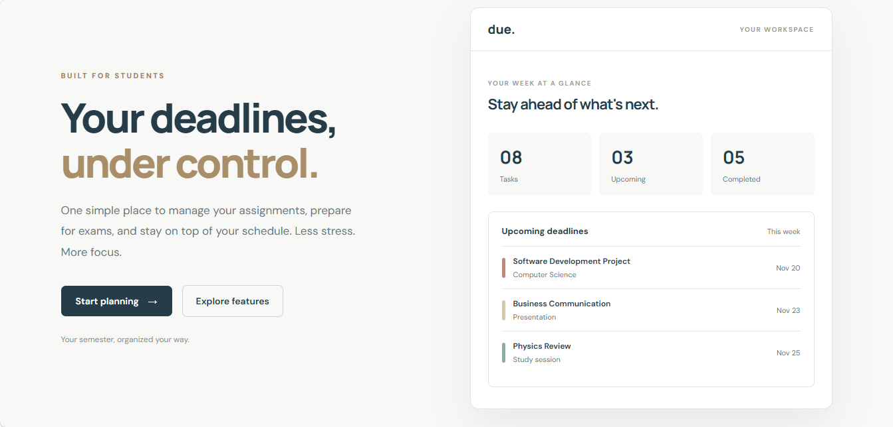
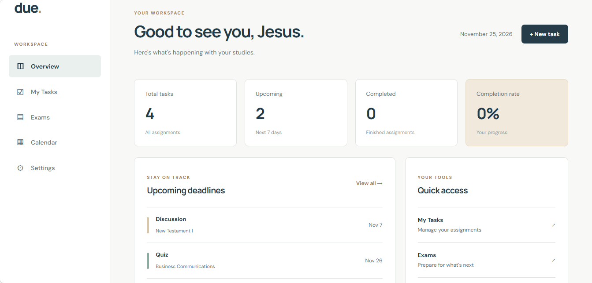
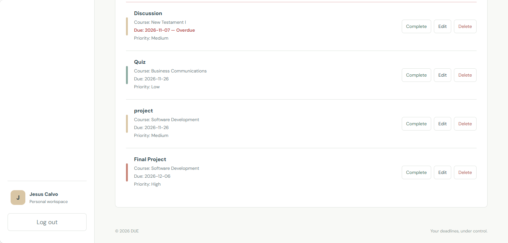
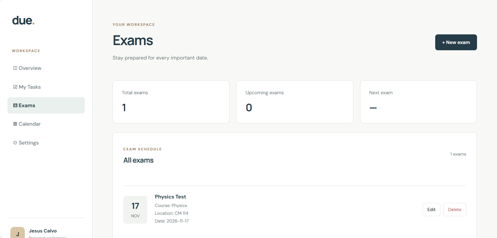
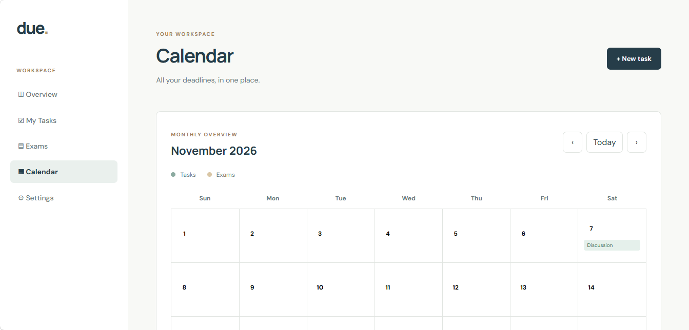
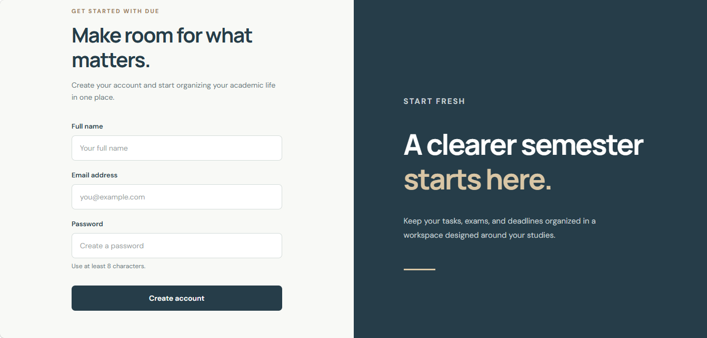
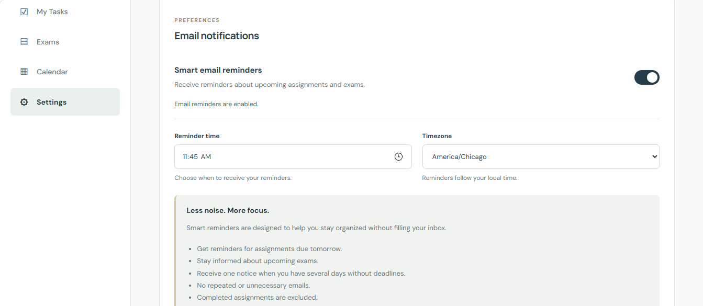
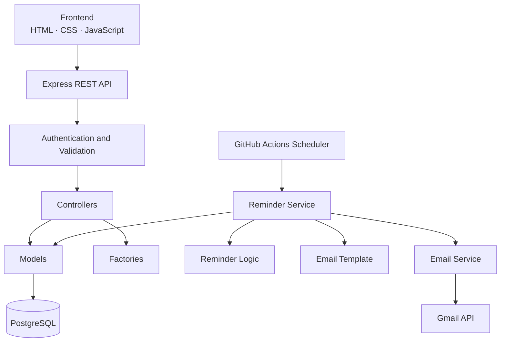
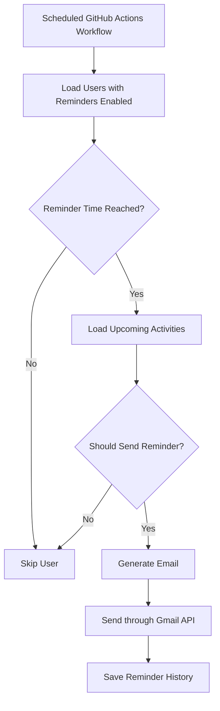
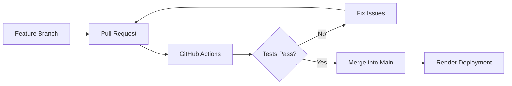

<div align="center">


<br>


[](https://github.com/jesuusss18/DUE/actions/workflows/ci.yml)


**A smarter way to manage academic life.**

DUE is a full-stack student planner that brings assignments, exams, deadlines, and personalized email reminders together in one organized workspace.

[Live Demo](https://due-66ut.onrender.com) · [Features](#features) · [Architecture](#architecture) · [Getting Started](#getting-started) · [Documentation](#documentation)

</div>

---

## Overview

Managing multiple classes, assignments, exams, and deadlines can become overwhelming. Students often use different platforms, calendars, and notes to keep track of their academic responsibilities.

DUE was created to simplify this process.

The application provides a centralized platform where students can organize their academic workload, track upcoming deadlines, monitor their progress, and receive personalized email reminders.

DUE was developed as a final Software Development project at Blue Mountain Christian University, applying software engineering principles throughout the entire development lifecycle.

## Features

| Feature | Description |
| :--- | :--- |
| Personal Dashboard | View academic progress and upcoming deadlines in one place. |
| Assignment Management | Create, edit, complete, and delete assignments. |
| Exam Management | Organize exams by course, date, and location. |
| Academic Calendar | Visualize assignments and exams in a monthly calendar. |
| Search and Filters | Find assignments by title, course, status, and priority. |
| Overdue Tracking | Identify incomplete assignments that are past their due date. |
| Smart Email Reminders | Receive personalized notifications about upcoming academic activities. |
| Notification Preferences | Customize reminder time, timezone, and email preferences. |
| Secure Authentication | Register and log in using password hashing and JWT authentication. |
| Personal Data Isolation | Access only the assignments, exams, and settings associated with your account. |

## Application Preview

## Application Preview

### A workspace designed for students

A clean and intuitive interface that brings academic responsibilities together in one place.

<div align="center">
    
</div>

### Explore the application

<table>
    <tr>
        <td width="50%" align="center">
            <b>Personal Dashboard</b>
            <br><br>
            
            <br><br>
            Track academic progress and upcoming deadlines.
        </td>
        <td width="50%" align="center">
            <b>Assignment Management</b>
            <br><br>
            
            <br><br>
            Manage tasks, priorities, and overdue assignments.
        </td>
    </tr>
    <tr>
        <td width="50%" align="center">
            <b>Exam Management</b>
            <br><br>
            
            <br><br>
            Organize exams, dates, courses, and locations.
        </td>
        <td width="50%" align="center">
            <b>Academic Calendar</b>
            <br><br>
            
            <br><br>
            Visualize academic deadlines in a monthly calendar.
        </td>
    </tr>
    <tr>
        <td width="50%" align="center">
            <b>Account Registration</b>
            <br><br>
            
            <br><br>
            Create a personalized academic workspace.
        </td>
        <td width="50%" align="center">
            <b>Smart Email Reminders</b>
            <br><br>
            
            <br><br>
            Customize notification preferences and local reminder times.
        </td>
    </tr>
</table>

<div align="center">

<i>Real screenshots from the DUE application.</i>

[Explore the Live Application](https://due-66ut.onrender.com)

</div>

### Dashboard

A centralized overview of academic responsibilities, progress, and upcoming deadlines.


### Assignment Management

Manage assignments, organize priorities, filter tasks, and track overdue deadlines.


### Academic Calendar

Visualize upcoming assignments and exams in an organized monthly calendar.


### Notification Preferences

Personalize automatic email reminders according to individual schedules and timezones.


## Technology Stack

| Layer | Technologies |
| :--- | :--- |
| Frontend | HTML5, CSS3, Vanilla JavaScript |
| Backend | Node.js, Express.js |
| Database | PostgreSQL |
| Authentication | JWT, bcryptjs, HTTP-only cookies |
| Email Notifications | Gmail API, OAuth 2.0, Nodemailer |
| Testing | Jest, Supertest, pg-mem |
| Version Control | Git, GitHub |
| CI/CD | GitHub Actions |
| Deployment | Render |
| Project Management | Jira, Agile Scrum |

## Architecture

DUE follows a layered architecture based on the Model-View-Controller (MVC) design pattern.

The application separates the user interface, business logic, database operations, and external services to improve maintainability and testability.



### Design Patterns

**Model-View-Controller (MVC)**

Separates data access, application logic, and the user interface.

**Factory Pattern**

Provides a consistent way to create assignment and exam objects with unique identifiers and default values.

**Middleware Pattern**

Handles authentication, resource ID validation, and centralized error responses before or around controller execution.

**Service Layer**

Separates email delivery and reminder processing from the main API controllers.

For additional details, see the [Architecture Documentation](docs/ARCHITECTURE.md).

## Smart Email Reminder System

DUE includes an automated notification system designed to keep students informed without sending unnecessary daily emails.

| Reminder Type | Behavior |
| :--- | :--- |
| Daily Reminder | Sends assignments and exams scheduled for the following day. |
| Gap Reminder | Informs the student about their next upcoming academic activity. |
| All Caught Up | Notifies the student when no upcoming assignments or exams remain. |

The reminder system respects user preferences and local timezones.

It excludes completed assignments and past activities, checks reminder history to avoid unnecessary repeated notifications, and records successfully sent reminders.



The workflow is scheduled approximately every 15 minutes. Actual execution and email delivery times may vary.

## Getting Started

### Prerequisites

- Node.js 22
- npm
- Git
- PostgreSQL database
- Google Cloud OAuth credentials for optional email reminders

### Installation

Clone the repository:

```bash
git clone https://github.com/jesuusss18/DUE.git
cd DUE
```

Install dependencies:

```bash
npm ci
```

### Environment Variables

Create a `.env` file in the root directory.

```env
PORT=3000
DATABASE_URL=your_postgresql_connection_string
JWT_SECRET=your_secure_random_secret

GOOGLE_CLIENT_ID=your_google_client_id
GOOGLE_CLIENT_SECRET=your_google_client_secret
GOOGLE_REDIRECT_URI=http://localhost:3000
GOOGLE_REFRESH_TOKEN=your_refresh_token

EMAIL_FROM=your_email_address
EMAIL_FROM_NAME=DUE
APP_URL=http://localhost:3000
```

The Google and email configuration is required only when using the email reminder system.

Never commit real credentials or `.env` files to GitHub.

### Initialize the Database

```bash
node database/init.js
```

### Start the Application

```bash
npm start
```

Open the application in your browser:

[http://localhost:3000](http://localhost:3000)

For development mode:

```bash
npm run dev
```

### Health Check

```http
GET /health
```

Expected response:

```json
{
    "status": "OK",
    "application": "DUE",
    "message": "Server is running"
}
```

The health endpoint verifies that the application server is responding.

## API Reference

### Authentication

| Method | Endpoint | Description |
| :--- | :--- | :--- |
| POST | `/api/auth/register` | Register a new account |
| POST | `/api/auth/login` | Authenticate a user |
| GET | `/api/auth/me` | Retrieve the current user |
| POST | `/api/auth/logout` | End the current session |

### Assignments

| Method | Endpoint | Description |
| :--- | :--- | :--- |
| GET | `/api/assignments` | Retrieve user assignments |
| POST | `/api/assignments` | Create an assignment |
| PUT | `/api/assignments/:id` | Update an assignment |
| DELETE | `/api/assignments/:id` | Delete an assignment |

### Exams

| Method | Endpoint | Description |
| :--- | :--- | :--- |
| GET | `/api/exams` | Retrieve user exams |
| POST | `/api/exams` | Create an exam |
| PUT | `/api/exams/:id` | Update an exam |
| DELETE | `/api/exams/:id` | Delete an exam |

### Settings

| Method | Endpoint | Description |
| :--- | :--- | :--- |
| GET | `/api/settings` | Retrieve notification preferences |
| PUT | `/api/settings` | Update notification preferences |

Assignment, exam, settings, and profile endpoints require authentication.

For request examples and error responses, see the [API Documentation](docs/API.md).

## Testing and Quality Assurance

DUE includes automated unit tests, integration tests, design pattern tests, and error handling tests.

### Testing Results

<div align="center">

| Automated Tests | Test Suites | Failed Tests |
| :---: | :---: | :---: |
| **224 / 224** | **17 / 17** | **0** |

</div>

### Code Coverage

| Metric | Coverage |
| :--- | ---: |
| Statements | **97.90%** |
| Branches | **93.39%** |
| Functions | **100%** |
| Lines | **97.84%** |

These results were recorded on November 25, 2026, using the selected backend modules, assignment search utility, and reminder execution script.

### Testing Strategy

- Unit testing for critical business logic.
- Integration testing for API and database interactions.
- Authentication and user ownership testing.
- MVC and Factory pattern verification.
- Email reminder and scheduling tests.
- Invalid input and error handling tests.
- Automated testing through GitHub Actions.

### Run Tests

```bash
npm test
```

### Generate Coverage Report

```bash
npm test -- --coverage --collectCoverageFrom="src/**/*.js" --collectCoverageFrom="public/assignmentSearch.js" --collectCoverageFrom="scripts/runReminders.js"
```

Automated tests use an in-memory PostgreSQL-compatible database and simulated Gmail API interactions. They do not require production credentials or send real emails.

For additional details, see the [Testing Documentation](docs/TESTING.md).

## Security and Reliability

DUE implements several measures to protect user information and improve application reliability.

- Password hashing using bcryptjs.
- JWT-based authentication.
- HTTP-only session cookies.
- User-specific database queries.
- Parameterized SQL queries.
- Server-side input validation.
- UUID validation for resource identifiers.
- Centralized error handling.
- Environment variables for sensitive credentials.
- Automated testing before merging changes.
- Reminder history with database uniqueness constraints.

The API returns appropriate HTTP status codes and avoids exposing internal server errors in client responses.

## Continuous Integration and Deployment

The application uses GitHub Actions for automated testing and scheduled email reminders.



### CI Workflow

The Continuous Integration workflow installs project dependencies and executes automated tests on pushes and pull requests.

### Email Reminder Workflow

A separate scheduled workflow processes automatic email reminders approximately every 15 minutes.

### Production Environment

The application and PostgreSQL database are hosted on Render.

**Live Application:** [due-66ut.onrender.com](https://due-66ut.onrender.com)

**Server Status:** [Health Endpoint](https://due-66ut.onrender.com/health)

For additional details, see the [Deployment Documentation](docs/DEPLOYMENT.md).

## Project Structure

```text
DUE/
├── .github/
│   └── workflows/
│       ├── ci.yml
│       └── reminders.yml
├── __tests__/
├── database/
│   ├── migrations/
│   └── init.js
├── docs/
├── public/
│   ├── index.html
│   ├── dashboard.html
│   ├── tasks.html
│   ├── exams.html
│   ├── calendar.html
│   └── settings.html
├── scripts/
│   ├── authorizeGmail.js
│   ├── testEmail.js
│   └── runReminders.js
├── src/
│   ├── config/
│   ├── controllers/
│   ├── factories/
│   ├── middleware/
│   ├── models/
│   ├── routes/
│   ├── services/
│   ├── templates/
│   └── utils/
├── tests/
│   └── testDatabase.js
├── .gitignore
├── package.json
├── package-lock.json
├── README.md
└── server.js
```

## Development Process

DUE was developed using an Agile Scrum approach organized into three development sprints.

| Sprint | Focus | Deliverables |
| :--- | :--- | :--- |
| Sprint 1 | Core MVP | Project setup, application structure, assignment management, backend architecture |
| Sprint 2 | Feature Development | Database integration, authentication, exams, calendar, email reminders |
| Sprint 3 | Testing and Deployment | Overdue tracking, comprehensive testing, CI/CD, error handling, documentation |

The development process included requirements analysis, user stories, acceptance criteria, risk analysis, sprint planning, feature branches, pull requests, and automated testing.

Jira was used to organize and track development tasks.

## Documentation

| Document | Description |
| :--- | :--- |
| [Architecture](docs/ARCHITECTURE.md) | System architecture, design patterns, and data flow |
| [API Reference](docs/API.md) | Endpoints, request examples, and response codes |
| [Testing](docs/TESTING.md) | Testing strategy, coverage, and test execution |
| [Debugging](docs/DEBUGGING.md) | Common problems and troubleshooting instructions |
| [Deployment](docs/DEPLOYMENT.md) | Hosting, environment configuration, and CI/CD |

## Known Limitations

- Automated integration tests use pg-mem rather than a live PostgreSQL instance.
- Gmail API interactions are simulated during automated testing.
- Scheduled reminders may experience delays.
- Reminder history reduces duplicate notifications but does not guarantee exactly-once email delivery.
- The health endpoint checks server availability, not database connectivity.
- Code coverage does not include every frontend interaction.

## Future Improvements

Potential future enhancements include:

- Recurring assignments.
- Academic progress analytics.
- Calendar synchronization.
- Email address verification.
- Push notifications.
- Mobile application support.

## Author

**Jesús Calvo Millán**

Computer Science Major · Mathematics Minor

Blue Mountain Christian University

[GitHub Profile](https://github.com/jesuusss18)

Developed as a final Software Development project to demonstrate full-stack development, software architecture, database integration, automated testing, and continuous deployment.

---

<div align="center">

**due.**

Your deadlines, under control.

Designed for students. Built with purpose.

</div>
