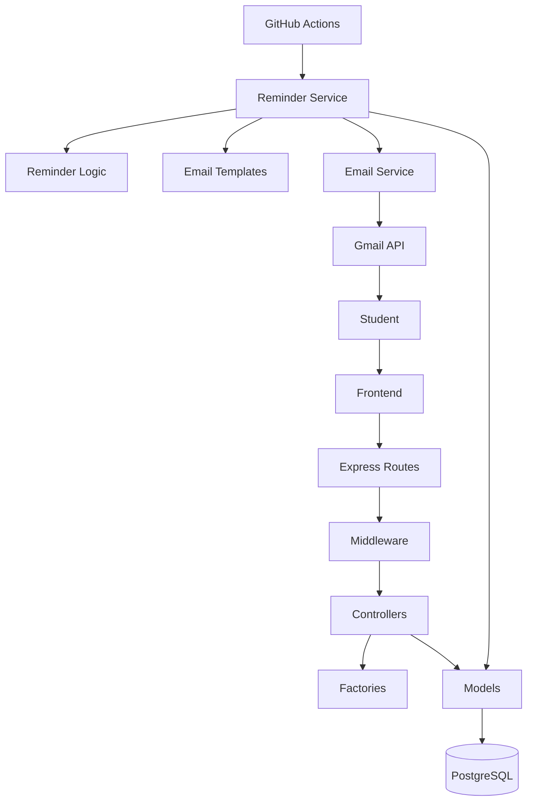
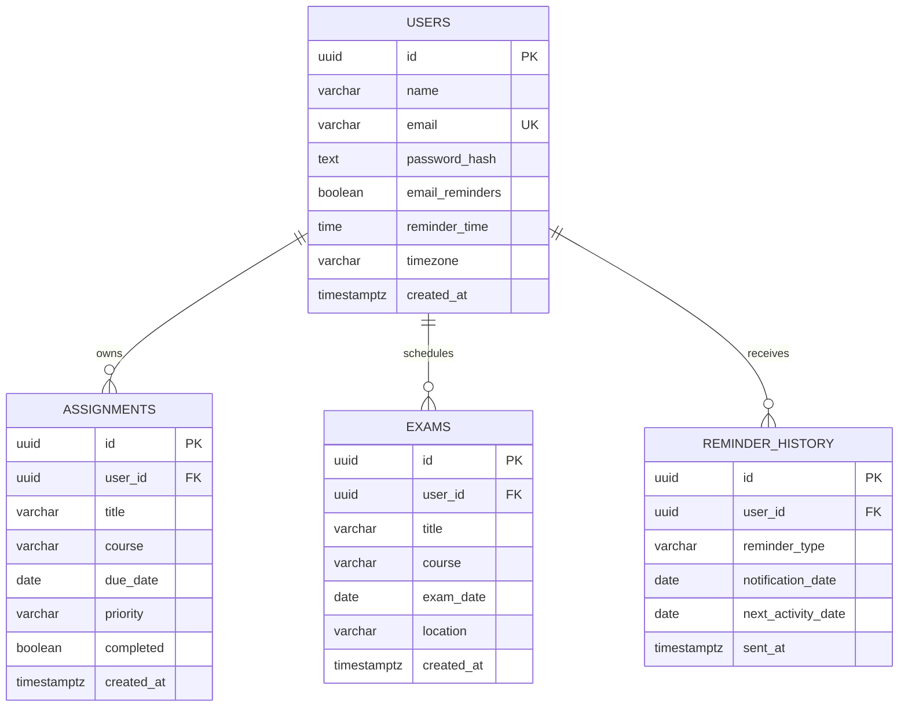
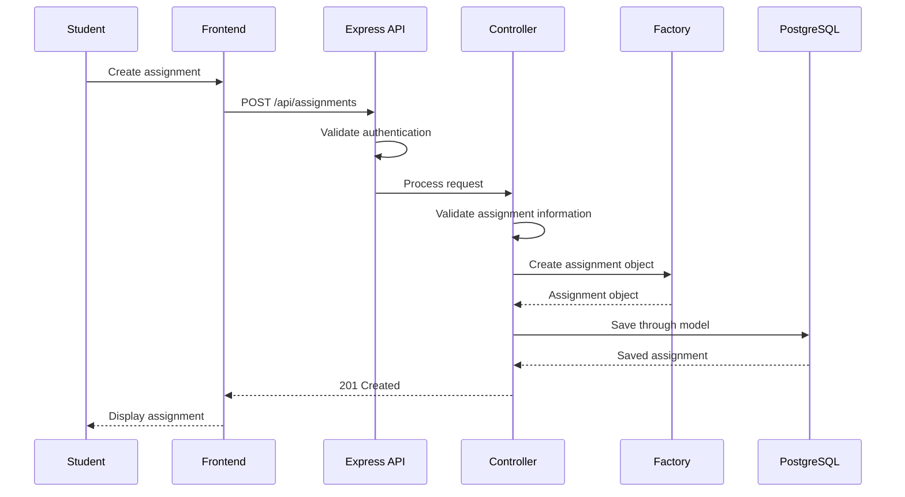

# DUE — Software Architecture

[Back to README](../README.md)

## 1. Architecture Overview

DUE is a full-stack web application designed to help students manage their academic responsibilities.

The application follows a layered architecture based on the Model-View-Controller (MVC) pattern. Each component has a specific responsibility, making the application easier to maintain, test, and extend.

## 2. System Architecture

## 3. Application Layers

| Layer | Responsibility | Directory |
| --- | --- | --- |
| View | User interface and interaction | `public/` |
| Routes | API endpoint definitions | `src/routes/` |
| Middleware | Authentication, validation, and error handling | `src/middleware/` |
| Controllers | Request processing and business operations | `src/controllers/` |
| Models | Database queries and data management | `src/models/` |
| Factories | Creation of assignment and exam objects | `src/factories/` |
| Services | Email delivery and reminder processing | `src/services/` |
| Utilities | Reusable business logic | `src/utils/` |
| Templates | Email content generation | `src/templates/` |
| Configuration | Database connection configuration | `src/config/` |

## 4. Design Patterns

### Model-View-Controller (MVC)

MVC separates the application into three main components:

- Model: manages database operations.
- View: displays information and receives user input.
- Controller: processes requests and connects the application layers.

This separation reduces dependencies between components and simplifies testing.

### Factory Pattern

DUE uses factories to create assignment and exam objects.

The factories generate unique identifiers, initialize default values, and prepare information before it is stored in the database.

Examples:

- `assignmentFactory.js`
- `examFactory.js`

### Middleware Pattern

Middleware functions handle shared responsibilities before or after controller execution.

- Authentication middleware validates JWT tokens.
- Resource validation middleware checks UUID formats.
- Error handling middleware manages unexpected errors.

### Service Layer

The reminder and email services separate external communication and notification processing from the main application controllers.

## 5. Database Design

DUE uses PostgreSQL as its relational database.

Each assignment, exam, and reminder record belongs to a registered user.

User-specific queries prevent users from accessing records belonging to other accounts.

The reminder history table includes a uniqueness constraint on the user ID and notification date to prevent duplicate history records.

## 6. Assignment Request Flow

## 7. Authentication and Security

DUE uses JWT authentication and bcrypt password hashing.

After a successful login, the server creates a signed authentication token and stores it in an HTTP-only cookie.

Protected endpoints validate the token before processing requests.

Additional security measures include:

- Parameterized database queries.
- Server-side input validation.
- User ownership verification.
- Environment variables for credentials.
- Generic error responses for unexpected failures.
- Secure session cookies in production.

## 8. Email Reminder Architecture

GitHub Actions executes the reminder script approximately every 15 minutes.

The script loads users with notifications enabled and checks their preferred reminder time using their configured timezone.

The reminder service retrieves upcoming assignments, exams, and notification history.

The reminder logic determines whether to send a daily reminder, gap reminder, or all-caught-up notification.

The email service sends the generated message through the Gmail API using OAuth 2.0.

Successful notifications are recorded in the database.

## 9. Architecture Decisions

| Decision | Reason |
| --- | --- |
| Vanilla JavaScript | Keep the frontend lightweight and understandable. |
| Express.js | Provide a simple REST API and middleware structure. |
| PostgreSQL | Support persistent relational data and constraints. |
| MVC | Separate responsibilities and improve maintainability. |
| Factory Pattern | Standardize object creation. |
| Gmail API | Support email delivery through OAuth authentication. |
| GitHub Actions | Automate testing and reminder execution. |
| Render | Host the application and database. |

## 10. Limitations

The current architecture is designed for a student productivity application.

Future improvements could include email verification, database connection health monitoring, stronger concurrent reminder protection, and additional frontend automation.

---

DUE — Software Architecture Documentation
