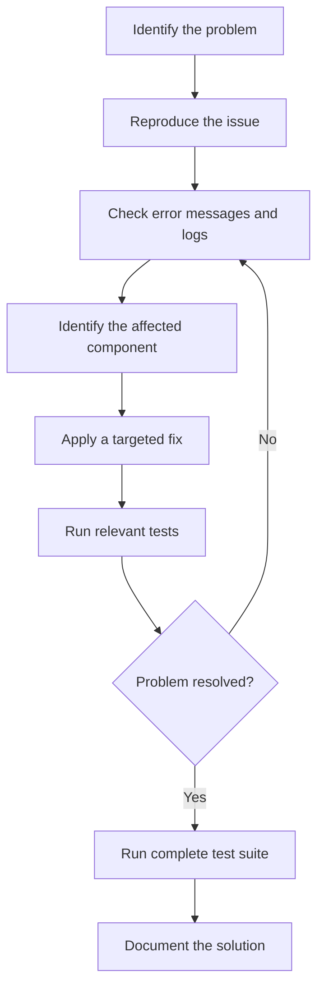

# DUE — Debugging and Troubleshooting Guide

[Back to README](../README.md)

## 1. Purpose

This guide explains how to identify, investigate, and resolve common problems in the DUE application.

It covers local development, database connectivity, authentication, automated testing, email reminders, GitHub Actions, and production deployment.

## 2. General Debugging Process



When investigating an issue:

1. Reproduce the problem.
2. Record the error message.
3. Check the browser console and server logs.
4. Identify the affected application layer.
5. Make a small, targeted correction.
6. Run the relevant tests.
7. Run the complete test suite before merging.

Avoid changing multiple unrelated components at the same time.

## 3. Application Does Not Start

### Error

`ERR_CONNECTION_REFUSED`

### Possible Causes

- The Node.js server is not running.
- The application is using a different port.
- The server stopped after an unexpected error.

### Solution

Start the application:

```bash
npm start
```

Verify that the terminal displays the application URL.

Open:

http://localhost:3000/health

If the server responds successfully, refresh the application in the browser.

## 4. Port Already in Use

### Error

`EADDRINUSE`

### Cause

Another application is using the configured port.

### Solution

On Windows, identify the process:

```cmd
netstat -ano | findstr :3000
```

Identify the process using the displayed PID:

```cmd
tasklist /FI "PID eq YOUR_PID"
```

Stop the process normally if it is safe to do so, or change the PORT value in the `.env` file.

Restart the application.

## 5. Missing Dependencies

### Error

`Cannot find module`

### Possible Causes

- Dependencies have not been installed.
- The node_modules directory is missing.
- A local file is missing or has an incorrect import path.

### Solution

Install the project dependencies:

```bash
npm ci
```

If the error refers to a local file, verify its filename, location, and import path.

## 6. Database Connection Problems

### Errors

- DATABASE_URL is missing.
- Connection timeout.
- Database authentication failure.

### Possible Causes

- Missing environment variables.
- Incorrect database credentials.
- Database server unavailable.
- Incorrect internal or external connection URL.

### Solution

Verify that the `.env` file contains a valid DATABASE_URL.

Use the appropriate database connection URL for the environment.

Check the database status in the Render dashboard.

For a new development database, initialize the schema:

```bash
node database/init.js
```

Never publish database credentials in screenshots, logs, or GitHub commits.

## 7. Authentication Errors

### Error

`401 Unauthorized`

### Possible Causes

- The user is not logged in.
- The authentication token has expired.
- The authentication cookie is missing.
- JWT_SECRET has changed.

### Solution

Log in again and retry the operation.

Use browser developer tools to inspect the request status and cookie configuration.

Verify that JWT_SECRET is configured correctly.

Do not disable authentication to solve a protected endpoint error.

## 8. Invalid Request Errors

### Error

`400 Bad Request`

### Possible Causes

- Missing required fields.
- Invalid dates.
- Invalid priority values.
- Invalid UUID.
- Text exceeding the allowed length.
- Malformed JSON.

### Solution

Inspect the request body using the browser Network tab.

Compare the request with the API documentation.

Verify the input values before sending the request again.

A 400 response is expected behavior when the submitted information is invalid.

## 9. Automated Test Failures

### Problem

A test returns a different status code or value than expected.

### Solution

Run the affected test file independently:

```bash
npm test -- integration.test.js
```

Read the expected and received values in the Jest output.

Inspect the relevant controller, middleware, or model.

After correcting the issue, run the complete test suite:

```bash
npm test
```

### Example from Development

During error handling testing, four integration tests expected HTTP 400 but received HTTP 401.

The cause was that the logout test executed before the new protected endpoint tests.

The shared authenticated session had already been removed.

The issue was resolved by moving the logout test to the end of the integration test file.

All 224 tests passed after the correction.

## 10. Email Reminders Are Not Received

### Possible Causes

- Email reminders are disabled.
- The configured reminder time has not been reached.
- The timezone is incorrect.
- The GitHub Actions workflow has not executed yet.
- A reminder has already been sent.
- Gmail OAuth credentials are invalid.
- The email was filtered as spam.

### Solution

Check the user's notification preferences.

Verify the reminder time and timezone.

Open the Email Reminders workflow in GitHub Actions and inspect the latest execution logs.

The workflow is scheduled approximately every 15 minutes. Delivery may not occur at the exact selected time.

Check the reminder history and upcoming academic activities.

If necessary, test the email configuration:

```bash
node scripts/testEmail.js
```

Configure TEST_EMAIL with a controlled test recipient before running this command.

The test email command sends a real email.

## 11. Gmail OAuth Errors

### Error

`invalid_grant`

### Possible Causes

- Expired or revoked refresh token.
- Incorrect OAuth credentials.
- Google OAuth application configuration issues.

### Solution

Review the OAuth configuration in Google Cloud.

Generate a new refresh token when necessary:

```bash
node scripts/authorizeGmail.js
```

Update the local environment variables and GitHub Actions secrets.

Run the email test script to verify the updated configuration.

Never expose OAuth credentials or refresh tokens.

## 12. GitHub Actions Failures

### Possible Causes

- Automated test failure.
- Dependency installation failure.
- Missing workflow secrets.
- Incorrect workflow configuration.

### Solution

1. Open the repository on GitHub.
2. Select the Actions tab.
3. Open the failed workflow.
4. Expand the failed step.
5. Read the error output.
6. Correct the issue in a feature branch.
7. Run local tests and push the correction.

Do not bypass required CI checks simply to merge a failing change.

## 13. Production Deployment Problems

### Problem

The production application does not display the latest changes.

### Possible Causes

- The pull request has not been merged.
- Render has not completed the deployment.
- Automatic deployment is disabled.
- The deployment failed.
- The browser is displaying cached content.

### Solution

Verify that the changes are present in the main branch.

Check the deployment status and logs in Render.

Confirm that the deployed commit matches the expected GitHub commit.

Refresh the browser using Ctrl + F5.

Verify the production health endpoint:

https://due-66ut.onrender.com/health

## 14. Logging and Monitoring

DUE provides error information through several sources.

| Source | Purpose |
| --- | --- |
| Browser Console | Frontend JavaScript errors |
| Browser Network Tab | HTTP requests and response codes |
| Local Terminal | Server errors and startup messages |
| Jest Output | Automated test failures |
| GitHub Actions Logs | CI and reminder workflow errors |
| Render Logs | Production application errors |

Unexpected server errors are logged internally, while clients receive general error messages.

Sensitive information should never be copied into public issue reports.

## 15. Useful Commands

| Command | Purpose |
| --- | --- |
| `npm ci` | Install dependencies |
| `npm start` | Start the application |
| `npm run dev` | Start development mode |
| `npm test` | Run all automated tests |
| `npm test -- integration.test.js` | Run integration tests |
| `node database/init.js` | Initialize database tables |
| `node scripts/testEmail.js` | Send a controlled test email |
| `git status` | Inspect local repository changes |
| `git log -5 --oneline` | Review recent commits |

## 16. Final Verification

Before completing a bug fix:

- Confirm that the original issue is resolved.
- Verify that related functionality still works.
- Run the complete automated test suite.
- Confirm that GitHub Actions passes.
- Document the cause and solution.
- Verify production behavior after deployment.

---

DUE — Debugging and Troubleshooting Guide
