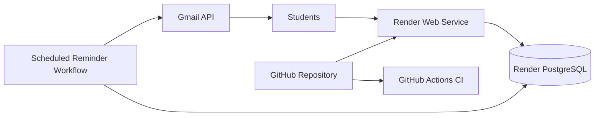
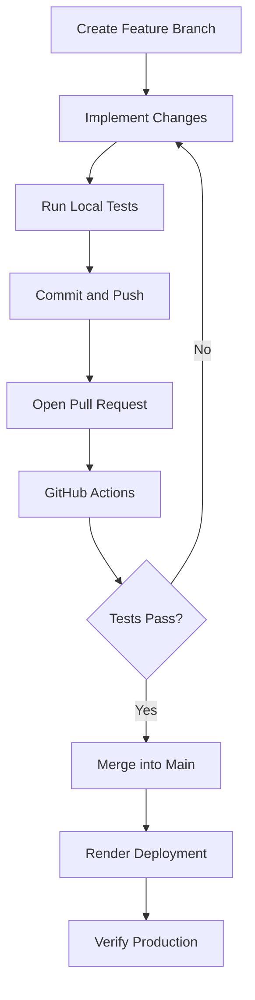

# DUE — Deployment and CI/CD

[Back to README](../README.md)

## 1. Production Environment

DUE is deployed using Render and GitHub Actions.

| Component | Platform |
| --- | --- |
| Source code | GitHub |
| Web application | Render |
| Database | Render PostgreSQL |
| Continuous integration | GitHub Actions |
| Scheduled reminders | GitHub Actions |
| Email delivery | Gmail API |
| Email authentication | Google OAuth 2.0 |

Live application:

https://due-66ut.onrender.com

Health endpoint:

https://due-66ut.onrender.com/health

## 2. Infrastructure Overview



## 3. Environment Configuration

Sensitive credentials are stored outside the source code.

### Application Variables

| Variable | Purpose |
| --- | --- |
| PORT | Application server port |
| DATABASE_URL | PostgreSQL connection string |
| JWT_SECRET | JWT signing secret |
| NODE_ENV | Application environment |
| APP_URL | Application URL |

### Email Variables

| Variable | Purpose |
| --- | --- |
| GOOGLE_CLIENT_ID | Google OAuth client identifier |
| GOOGLE_CLIENT_SECRET | Google OAuth client secret |
| GOOGLE_REDIRECT_URI | OAuth redirect URI |
| GOOGLE_REFRESH_TOKEN | OAuth refresh token |
| EMAIL_FROM | Sender email address |
| EMAIL_FROM_NAME | Sender display name |
| TEST_EMAIL | Controlled local test recipient |

TEST_EMAIL is used for local email testing. It is not required by the scheduled reminder workflow.

Environment variables and real credentials must never be committed to the repository.

## 4. Render Web Service

The production web service is connected to the GitHub repository.

Deployment branch:

`main`

Build command:

```bash
npm ci
```

Start command:

```bash
npm start
```

Health check path:

```text
/health
```

Configure the required application environment variables in Render.

Set NODE_ENV to production so that production-specific session cookie settings are applied.

## 5. PostgreSQL Database

The production database is hosted on Render.

The application connects to PostgreSQL using DATABASE_URL.

The Render web service can use the appropriate internal database connection URL when supported by its environment.

External services, such as GitHub Actions, require an externally accessible database connection.

Database initialization:

```bash
node database/init.js
```

Existing databases may require the relevant migration scripts.

Database initialization and migrations should be performed carefully and against the intended database.

## 6. Continuous Integration

Workflow location:

`.github/workflows/ci.yml`

The CI workflow runs on pushes and pull requests.

The workflow:

1. Checks out the repository.
2. Configures Node.js 22.
3. Installs dependencies using npm ci.
4. Executes npm test.
5. Reports the result to GitHub.

Automated tests use mocked external services and an in-memory database.

Production credentials are not required for the automated test suite.

## 7. Branching and Pull Requests

DUE follows a feature branch development workflow.



The main branch is protected through GitHub branch protection settings.

Required CI checks help prevent failing changes from being merged.

## 8. Continuous Deployment

Render is configured to deploy changes from the main branch automatically.

After a pull request is merged:

1. Render detects the new commit.
2. The application is built.
3. The web service starts the updated version.
4. The deployment status is reported in Render.

Verify the application and health endpoint after deployment.

## 9. Scheduled Email Reminders

Workflow location:

`.github/workflows/reminders.yml`

The workflow uses the following cron schedule:

```text
7,22,37,52 * * * *
```

This schedules execution approximately every 15 minutes.

GitHub Actions scheduling uses UTC, while the application checks each user's configured local timezone and reminder time.

The workflow executes:

```bash
node scripts/runReminders.js
```

The reminder script:

- Retrieves users with reminders enabled.
- Checks their preferred reminder time.
- Retrieves upcoming assignments and exams.
- Evaluates reminder history.
- Sends eligible notifications.
- Records successfully sent reminders.
- Closes the database connection.

Actual execution times may vary because scheduled GitHub Actions workflows can experience delays.

## 10. GitHub Actions Secrets

The reminder workflow requires the following secrets:

- DATABASE_URL
- GOOGLE_CLIENT_ID
- GOOGLE_CLIENT_SECRET
- GOOGLE_REDIRECT_URI
- GOOGLE_REFRESH_TOKEN
- EMAIL_FROM
- EMAIL_FROM_NAME
- APP_URL

These secrets are configured under the repository's Actions secrets settings.

The scheduled reminder workflow does not depend on a developer's local computer being online.

## 11. Email Configuration

DUE uses Gmail API with OAuth 2.0 authentication.

The OAuth authorization script is located at:

`scripts/authorizeGmail.js`

The local email test script is located at:

`scripts/testEmail.js`

OAuth credentials must be configured before enabling real email delivery.

The email test script should only be executed with a controlled recipient.

## 12. Production Verification Checklist

After deploying a new version:

- [ ] Confirm the deployment completed successfully.
- [ ] Verify the deployed commit.
- [ ] Open the production health endpoint.
- [ ] Verify registration and login.
- [ ] Verify assignment management.
- [ ] Verify exam management.
- [ ] Verify calendar functionality.
- [ ] Verify notification preferences.
- [ ] Review GitHub Actions results.
- [ ] Review Render logs for unexpected errors.

## 13. Deployment Limitations

- Scheduled GitHub Actions workflows may experience delays.
- Gmail API delivery depends on valid OAuth credentials and service limits.
- The health endpoint does not verify database connectivity.
- Automated tests do not replace production verification.
- Reminder history does not guarantee exactly-once email delivery.

## 14. Future Infrastructure Improvements

Potential improvements include separate staging and production environments, enhanced monitoring, database readiness checks, stronger reminder concurrency protection, and additional production smoke tests.

---

DUE — Deployment and CI/CD Documentation
